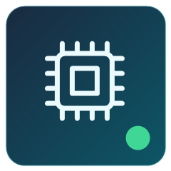

这个项目存储着 WinLand 插件开发代码

根目录每一个文件夹都是一个独立的项目，包含全部源代码

插件在这里管理代码，编译后产物提交到市场。

## 插件列表

| Logo | 插件名（中文） | 插件名（English） | 插件 ID | 版本 | 说明 | 详情 |
| :---: | --- | --- | --- | :---: | --- | :---: |
|  | **硬件传感器** | Hardware Sensors | `hw-sensors` | `1.0.0` | 小岛显示 CPU 温度与功耗，展开看 CPU/GPU 温度、功耗、占用、整机预估功耗与电池状态 | [README](hw-sensors/README.md) |
|  | **外设电量** | Peripheral Battery | `peripheral-battery` | `1.1.0` | 在灵动岛上显示无线键鼠、耳机、手柄的剩余电量，低电量自动提醒 | [README](peripheral-battery/README.md) |

> 版本号取自各插件目录下的 `plugin.json`。
